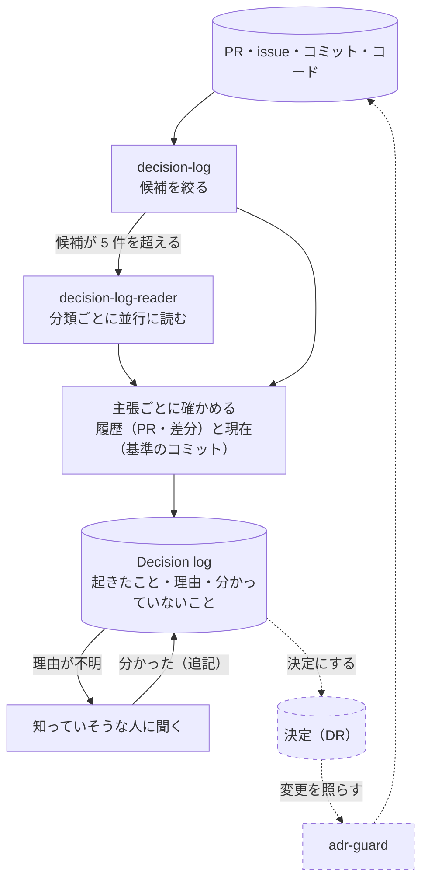

# decision-continuity

過去の変更から、何が起きたか・なぜか・何が分かっていないかを Decision log に起こし、決定につなげる。

## 流れ

実線が使える部分（[decision-log](adr/skills/decision-log/SKILL.md) と [decision-log-reader](adr/agents/claude/decision-log-reader.md)）、点線が再考中の部分。
