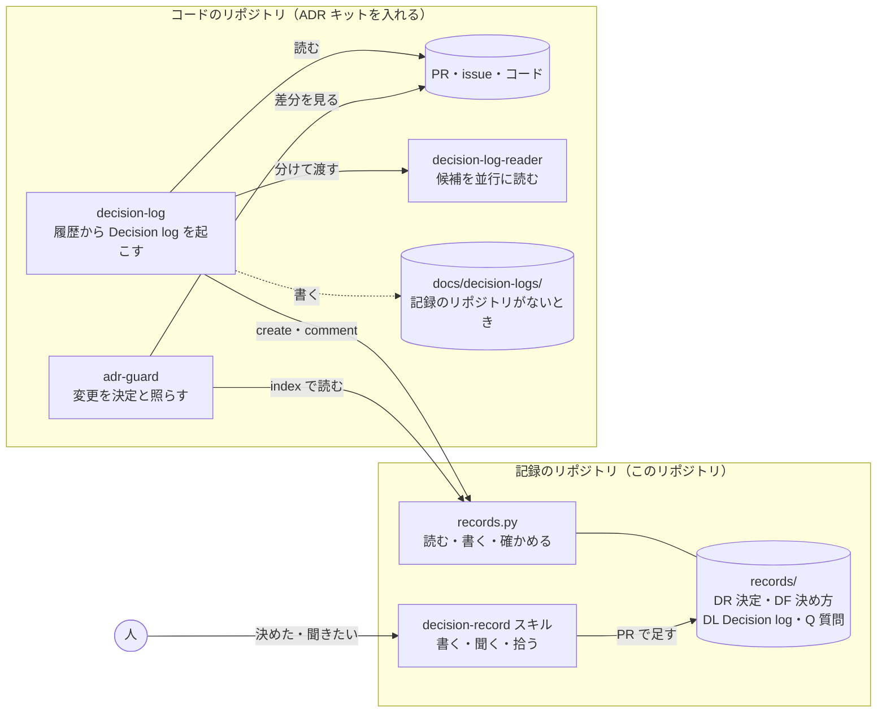

# decision-records

組織の意思決定を、あとから探せる形で残す場所と、そのためのスキル。

## なぜやるのか

**誰が決めてよいかが分かれば、人は決められる。** 過去に何が、誰によって、どんな前提で決まったかが見えると、「これは自分が決めていい」「この人と話せばいい」が分かります。この「決める動力」を組織として生み出し続けるのが、いちばんの目的です。

残っていると、次のことも起きます。

- 同じ議論を繰り返さない：「前にこう決めた、理由はこう」から始められる。説明は一回で済み、あとはリンクを貼るだけ。
- 外れたときに人ではなく前提を直せる：決めたときの前提と、その後の結果を並べられる。
- 決め方が資産になる：一度決めた「誰の承認で決まるか」が、別の変更でもそのまま使える。
- AIに渡せる文脈になる：組織がどう判断してきたかは、AIに意図を渡すときの一番の材料になる。人のレビューも、コードの差分から、決定に書かれた意図へ移っていく。

## 背景

作ることが速くなるほど、遅れの多くは人の意思決定を待つ時間になり、意思決定が人に残る役割の中心になります。特に部署をまたぐ変更では、技術ではなく「誰が決めれば決まるか」のあいまいさが壁になります。

実際、部署横断のリリースフロー変更が長く止まりました。止まった理由は反対ではなく、誰の承認で決まるかが決まっていなかったことです。「影響を受ける部署の組織長全員の承認で決定とする」と決め方を決めると一気に進み、その決め方は後日、別の部門の変更でもそのまま使われました。

一方、「あなたが決めたことはどこに残っているか」と聞くと、こう返ってきます。

| どこに | 残っているもの | 抜けているもの |
|---|---|---|
| ToDo、Confluence | 何をするか | なぜ決めたか、今も有効か、他の人が見つけられるか |
| GitHub のコード | 決めた結果（振る舞い） | なぜそうしたか、他の案。コードが変わると痕跡ごと消える |
| 意思決定者に話した | なし（二人の記憶だけ） | すべて。誰が決めたかの認識も食い違いうる |

部署や階層をまたいだ判断ほど、残っていません。

## 残す意思決定

次のどれかに当てはまる判断を残します。

- 他の人や部署に影響する
- 後で理由を問われそう
- 戻しにくい

| 種類 | 例 |
|---|---|
| 技術 | 標準技術の採用・入れ替え・廃止、アーキテクチャの方針、基盤の移行、挙動を決める設定（タイムアウト、リトライ回数など） |
| プロダクト | 仕様の線引き、リリースのタイミング、やらないと決めたこと |
| 組織・運用 | 運用ルール、通知先や承認の手順、会議体、チームの責任範囲 |
| 事業・経営 | 投資の強化・縮退・撤退、優先順位の判断 |
| 決め方 | 誰が決める・承認するか。下位の組織長への委譲（「この件は〇〇が決めてよい」）、合意の手順（「影響を受ける組織長全員の承認で決定」）、上位での決定（「CTO・経営が決める。その前に必要な評価はこれ」） |

**やらないと決めたこと**も残します。作れることが増えるほど、何を作らないかの判断が大事になるためです。

決めた人は、名前ではなく**役割と組織**（例：決済チームのチームリード、CTO）で書きます。人の異動や退職で記録が古くならず、「この種類の判断はどの役割が決めてきたか」がそのまま読めるためです。

記録は、誰がいくつ決めたか、外れたかで人を評価するのに使いません。

### 残さないもの

- 自分や自チームで完結し、すぐ戻せる日々の判断
- 雑談、ブレインストーミング、検討中の議論（重い判断を「書いてから決める」ときの提案は除く）
- 人事（評価・異動・処遇・個人の情報）に関わる判断。限定の場所に手で残す

## 構成

- **記録**：このリポジトリの `records/`（1 件 1 ファイルの Markdown）
  - 決めたこと（技術／プロダクト／組織・運用／事業・経営）
  - 決め方：誰が決める・承認するか
  - Decision logs：コードのリポジトリで過去に起きた変更の観察。決定ではなく、縛らない
  - Q&A：「なんでこうなってる？」の質問。答えが付いたら記録にする
- **スキル**：`decision-record`（`.claude/skills/` と `.kiro/skills/`）。記録を読み書きする `records.py` も同じフォルダーにある
- **設定**：`config.yaml`（役割の一覧、拾ってよいチャンネルなど）
- **評価ケース**：`evals/cases.yaml`
- **ADR キット**：`adr/`。コードのリポジトリに入れて、変更をこの記録と照らし（adr-guard）、過去の変更を Decision logs に起こす（decision-log）。技術の決定もここの Decisions に置く（[adr/README.md](adr/README.md)）

## 使い方

このリポジトリを開いて、Claude Code か Kiro に話しかけます。

- 「なんでタイムアウト5秒なの？」
- 「部署をまたぐ変更って誰が承認すれば決まる？」
- 「これ自分で決めていい？」
- 「このスレッドから記録を作って」

`records/` にファイルを足す PR を出し、直接書くこともできます（[records/README.md](records/README.md)）。
