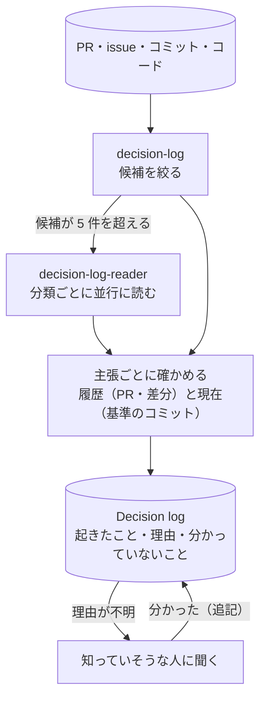

# decision-continuity

コードのリポジトリの履歴から、何が起きたか・なぜか・何が分かっていないかを Decision log に起こすスキル。Claude Code と Kiro で動く。

## 流れ



## 入れ方

| 写すもの | Claude Code | Kiro |
|---|---|---|
| [skills/decision-log/](skills/decision-log/SKILL.md) | `.claude/skills/decision-log/` | `.kiro/skills/decision-log/` |
| [agents/](agents/) の decision-log-reader | `claude/` の `.md` を `.claude/agents/` | `kiro/` の `.json` と `.md` を両方 `.kiro/agents/` |

使うときは「認証まわりがなぜこうなったか、履歴から起こして」のように頼む。既定は読むだけ（`audit`）で、書くのは `write` と頼んだときだけ。

### Claude Code で確認を減らす

スキルの `allowed-tools` がサブエージェント（decision-log-reader）にも効くかは、公式ドキュメントに書かれていない。reader のコマンドに毎回確認が出るときは、読むだけのコマンドを `.claude/settings.json` に足す（メインの会話とサブエージェントの両方に効く）。書くコマンド（`git commit`・`git push`・`gh pr create` など）は足さない。

```json
{
  "permissions": {
    "allow": [
      "Bash(git log *)", "Bash(git show *)", "Bash(git grep *)", "Bash(git rev-parse *)",
      "Bash(git remote get-url *)", "Bash(TZ=Asia/Tokyo git log *)",
      "Bash(gh pr view *)", "Bash(gh issue view *)", "Bash(gh release view *)",
      "Bash(glab mr view *)", "Bash(glab issue view *)"
    ]
  }
}
```

Kiro は、`agents/kiro/` の定義に読むだけのコマンドの許可が入っている。

## 確かめる

- テスト：`python3 -I -m unittest discover -s tests`
- 実際のエージェントでの評価：[evals/cases.md](evals/cases.md)

[MIT License](LICENSE)
