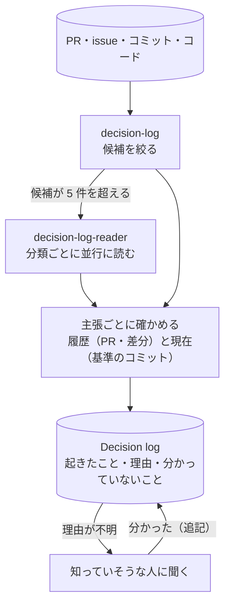

# decision-continuity

意思決定の経緯を途切れさせないための、スキルとサブエージェントの集まり。組み合わせて使う。Claude Code と Kiro で動く。

| 名前 | 種類 | すること |
|---|---|---|
| [decision-log](skills/decision-log/SKILL.md) | スキル | コードのリポジトリの履歴から、何が起きたか・なぜか・何が分かっていないかを Decision log に起こす |
| [decision-log-reader](agents/claude/decision-log-reader.md) | サブエージェント | decision-log の候補を分類ごとに並行に読み、決まった形で返す |

## decision-log の流れ



## 入れ方

| 写すもの | Claude Code | Kiro |
|---|---|---|
| [skills/decision-log/](skills/decision-log/SKILL.md) | `.claude/skills/decision-log/` | `.kiro/skills/decision-log/` |
| [agents/](agents/) の decision-log-reader | `claude/` の `.md` を `.claude/agents/` | `kiro/` の `.json` と `.md` を両方 `.kiro/agents/` |

使うときは「認証まわりがなぜこうなったか、履歴から起こして」のように頼む。既定は読むだけ（`audit`）で、書くのは `write` と頼んだときだけ。

### Claude Code で確認を減らす

スキルの `allowed-tools` がサブエージェント（decision-log-reader）にも効くかは、公式ドキュメントに書かれていない。reader のコマンドに毎回確認が出るときは、読むだけのコマンドを `.claude/settings.json` に足す（メインの会話とサブエージェントの両方に効く）。書くコマンド（`git commit`・`git push`・`gh pr create` など）は足さない。

```json
{
  "permissions": {
    "allow": [
      "Bash(git log *)", "Bash(git show *)", "Bash(git grep *)", "Bash(git rev-parse *)",
      "Bash(git remote get-url *)", "Bash(TZ=Asia/Tokyo git log *)",
      "Bash(gh pr view *)", "Bash(gh issue view *)", "Bash(gh release view *)",
      "Bash(glab mr view *)", "Bash(glab issue view *)",
      "Bash(gh api repos/*)"
    ],
    "deny": [
      "Bash(gh api *-X*)", "Bash(gh api *--method*)", "Bash(gh api *-f*)",
      "Bash(gh api *-F*)", "Bash(gh api *--input*)"
    ]
  }
}
```

`gh api repos/*` は、`gh pr view` が使えない環境（GraphQL が止められているなど）で PR を REST API で読むため。書き込みになる指定（`-X`・`-f` など）は `deny` で止める。

Kiro は、`agents/kiro/` の定義に読むだけのコマンドの許可が入っている。

このリポジトリ自身の経緯は、decision-log で起こして [docs/decision-logs/](docs/decision-logs/README.md) に置いている（組織の記録の置き場所ではない）。

## 限界

- 差分の洗い出しは、決まった言葉と定数・設定ファイルで候補を拾う。言葉の出てこない振る舞いの変更は拾えない。
- 手順書や仕様の文書が中心のリポジトリでは、言葉の洗い出しがほぼ全件に当たり、絞り込みに使えない。コードのリポジトリ向け。
- リポジトリの外の変更（インフラの設定、管理画面のフラグ）は履歴に残らないので見えない。

## 確かめる

- テスト：`python3 -I -m unittest discover -s tests`（Python 3.10 以降。フロントマターの検査には PyYAML が要り、なければその検査だけ飛ばす）
- 実際のエージェントでの評価：スキルごとに `evals/<スキル名>/`（[decision-log](evals/decision-log/cases.md)）

[MIT License](LICENSE)
