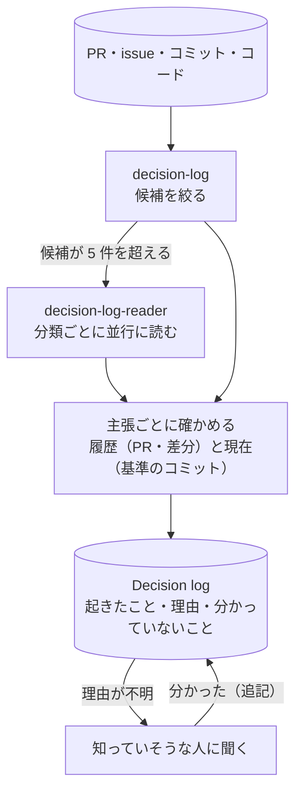

# decision-continuity

コードのリポジトリの履歴から、何が起きたか・なぜか・何が分かっていないかを Decision log に起こすスキル。

## 流れ

## 入れ方

| 写すもの | Claude Code | Kiro |
|---|---|---|
| [skills/decision-log/](skills/decision-log/SKILL.md) | `.claude/skills/decision-log/` | `.kiro/skills/decision-log/` |
| [agents/](agents/) の decision-log-reader | `claude/` の `.md` を `.claude/agents/` | `kiro/` の `.json` と `.md` を両方 `.kiro/agents/` |

使うときは「認証まわりがなぜこうなったか、履歴から起こして」のように頼む。既定は読むだけ（`audit`）で、書くのは `write` と頼んだときだけ。

テスト：`python3 -I -m unittest discover -s tests`
