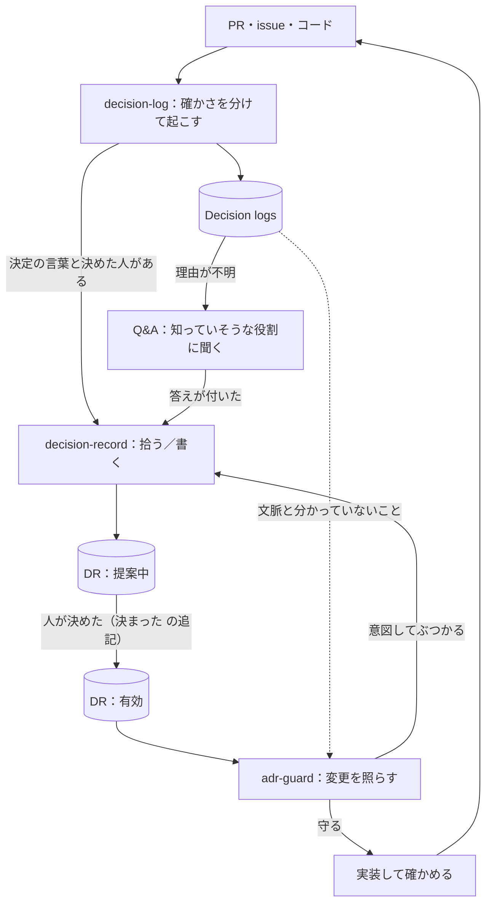

# Decision Continuity：決定と、起きたことを分けて残す

起きたこと（Decision log）と、意図して決めたこと（DR）を分けて残す。どちらもこのリポジトリの `records/` に Markdown で置き、コードのリポジトリのエージェントが `records.py` で読む。

## 記録の種類

| | Decision log | 決定（DR） |
|---|---|---|
| 問い | 何が起きたか、何が分かっていないか | これからどうするか、なぜか、誰が決めたか |
| 材料 | PR、コード、テスト、レビュー、戻した変更 | 決定の言葉、決めた人、他の案、前提 |
| 状態 | なし（過去の観察） | 提案中 → 有効 → 終了 |
| 縛るか | 縛らない | 有効なものだけ縛る |
| 育て方 | 後の変化や訂正を追記で足す | 結果・崩れた前提・探し方の直しを追記で足す。決め直すときは新しい DR |

マージされた PR は変更が入った証拠で、方針が決まった証拠ではない。見えている実装から、有効な DR を作らない。

## 全体の流れ

## 探し方

索引のファイルは持たない。各 DR の記録データが索引の 1 行の代わりになる。

| 索引にあったもの | 移した先 |
|---|---|
| 決定の一文 | タイトル |
| パス | `paths`（前方一致） |
| キーワード | `keywords`（決定の文に出てこないのに、変更の側に出てくる言葉。コードの識別子と言い換え） |
| 状態 | 「終了」の追記があるか、`status`、「決まった」の追記 |
| どのリポジトリか | `repos`（全リポジトリなら `all`） |

adr-guard は `records.py index --repo <名前>` で、関係する記録を全部並べ、パス・キーワード・意味の三つで照らす。パスが変わった、キーワードが足りなかったときは、「探し方を更新」の追記で最新の一覧を足す。本文は書き換えない。

## 読めなかったとき

`records.py` は、読めなかったとき終了コード 2 を返す。adr-guard は「関係する決定はない」とせず、「読めなかった」と報告する。黙って進むのが一番危ないため。

## 限界

- コードの変更と記録の更新は同じ PR に入らない。adr-guard は PR に「マージのあとに追記が要る記録」を書く。
- 誰が有効にしたかは、「決まった」の追記の元の場所と、`approved_via` の決め方で確かめる。GitHub の権限は、決める役割を表していない。
- 意味で照らす部分は、エージェントの読みに頼る。合う記録がないことは、安全の証拠ではない。

## スキルと評価

スキルは [adr-guard](skills/adr-guard/SKILL.md) と [decision-log](skills/decision-log/SKILL.md)、共通の決まりは [decision-continuity-contract.md](skills/decision-continuity-contract.md)。決定を書くのは `decision-record`。[ケースの一覧](evals/scenario-tests.md) と [実行スクリプト](evals/agent-runner.md) で、実際のエージェントで確かめる。
