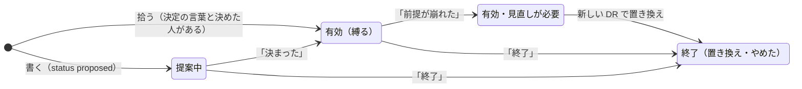
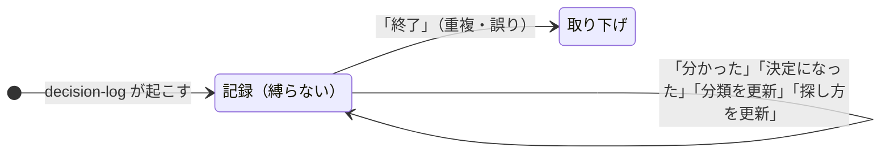

# records

決定の記録（DR）の置き場所。1 件 1 ファイルの Markdown で、変更は PR で入れる。既定のブランチにマージされたら保存されたことになる。手順・型の正本は [decision-record スキル](../.claude/skills/decision-record/SKILL.md)。

| フォルダー | 種類 | 縛るか |
|---|---|---|
| `decisions/` | 決めたこと（Decisions） | 有効なものだけ縛る |
| `decision-flows/` | 決め方：誰が決める・承認するか（Decision flows） | 有効なものだけ縛る |
| `decision-logs/` | 過去に起きた変更の観察（Decision logs） | 縛らない |
| `questions/` | 「なんでこうなってる？」の質問（Q&A） | 縛らない |

## ファイル

- 名前は `0042.md` か `0042-no-pii-in-logs.md`。先頭の 4 桁が番号で、フォルダーをまたいだ通し番号。
- 記録を指すときは、種類の接頭辞を付けて `DR-42`（決定）、`DF-12`（決め方）、`DL-17`（Decision log）、`Q-30`（Q&A）と書く。`#42` と書かない（GitHub が issue・PR #42 へのリンクにしてしまうため）。
- 先頭は記録データ（YAML のフロントマター。`---` と `---` で挟む）。その下が `# タイトル`（何を決めたかが分かる一行）、さらにその下が本文（形はスキルの「本文の書き方」）。
- 人事（評価・異動・処遇・個人の情報）に関わる判断はここに書かない。

## 追記だけで育てる

マージしたあとは、本文も過去の追記も書き換えない。ファイルを消したり、名前やフォルダーを変えたりもしない。結果・崩れた前提・探し方の直し・終了は、ファイルの末尾に足す。

```markdown
---

## 追記 2026-11-02（書いた人）

**決まった**（2026-11-02）：決めた人（役割）、承認した人、元の場所
```

一行目の印で読み方が変わる。

| 印 | 意味 |
|---|---|
| `**決まった**` | 提案中の DR が有効になった |
| `**探し方を更新**` | `repos`・`paths`・`keywords` を最新の一覧まるごとで置き換える |
| `**前提が崩れた**` | 縛るが「見直しが必要」 |
| `**分類を更新**` | Decision log の `category` を置き換える（分類の一覧は decision-log スキル） |
| `**分かった**` | Decision log の「分かっていないこと」に答えが出た。理由だけで、決定ではない |
| `**決定になった**` | Decision log の観察をもとに、人が決定（DR）を作った |
| `**終了**` | 終わった。一行目に「置き換え」があれば置き換え（例：`**終了**（2026-11-02）：DR-57 に置き換え`）、なければやめた |

二つ目からの追記は `---` を付けず、`## 追記 …` の見出しから続ける。

### 状態の移り変わり

決定（DR）と決め方（DF）は、追記の印で状態が変わる。Decision log（DL）は縛らないので状態がなく、取り下げるときだけ「終了」を足す。





「決定になった」は Decision log を変えない。決定は、別の新しい DR として作られる（DR の本文に「DL-<番号> の観察にもとづく」と書く）。

## records.py で読み書きする

リポジトリのルートで:

```sh
python3 .claude/skills/decision-record/records.py index                 # 一覧
python3 .claude/skills/decision-record/records.py show DR-42            # 本文・追記・参照している記録
python3 .claude/skills/decision-record/records.py create --category decisions --title "…" --body-file body.md
python3 .claude/skills/decision-record/records.py comment DR-42 --body-file note.md
python3 .claude/skills/decision-record/records.py check --base origin/main   # PR の前に
```

PR では GitHub Actions（`records`）が `check` を回し、番号の重なりと、追記以外の書き換えを止める。
